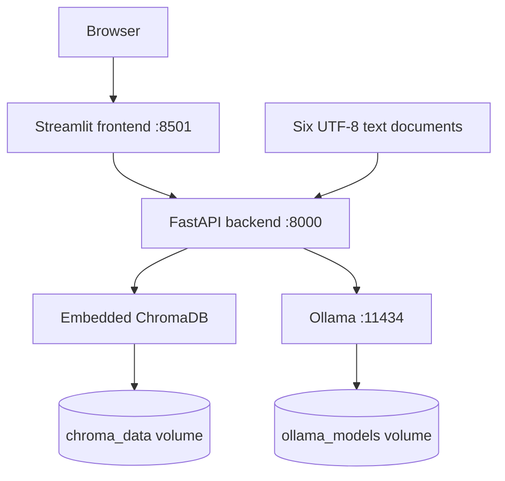

# Containerized RAG Chatbot

A local document chatbot with a FastAPI backend, a Streamlit chat interface, persistent ChromaDB storage, and Ollama inference. Start the complete application with **`docker compose up`**. Missing models download automatically, and the included corpus is indexed on startup.

## Quick start on Windows

1. Extract the project ZIP. Open **Docker Desktop** and wait until its engine is running in Linux containers mode.
2. Open PowerShell in the extracted `containerized-rag` folder. The folder should contain `docker-compose.yml`.
3. Start the stack:

   ```powershell
   docker compose up --build
   ```

4. Wait for model downloads, indexing, and service healthchecks. First startup can take several minutes or longer on a slow connection or CPU.
5. Open **[Document Chat](http://localhost:8501)**. The sidebar should show six documents and a nonzero chunk count.
6. Ask: **How do named volumes preserve data when containers are recreated?** Expand **Sources** to inspect the cited evidence.

The ZIP includes a safe, non-secret `.env` so this first run needs no configuration edits. For a fresh Git clone, create it first:

```powershell
Copy-Item .env.example .env
docker compose up
```

`docker compose up` builds missing images and starts the application. This project uses `pull_policy: build` for its two local images, so subsequent starts also check their cached build layers. `docker-compose up` is the equivalent spelling on installations that provide that command.

Docker supplies Python and Ollama inside the containers. Initial Docker image and model downloads require internet access. After those downloads, inference and document processing run locally without a hosted inference API. CPU execution is the default. Allow sufficient Docker memory for both models and the services; 8 GB allocated memory is a practical starting point, with actual needs depending on context size and platform.

## Architecture



There are exactly **three Compose services**: `backend`, `frontend`, and `ollama`. ChromaDB runs as a Python library inside the backend. Ollama hosts both the chat model and the embedding model. The backend waits for Ollama's model-aware healthcheck; the frontend waits for backend readiness.

During startup, `scripts/start-ollama.sh` starts the Ollama server and downloads any missing configured models in the same service. The backend then ingests the corpus. Models and indexed data survive ordinary container recreation through separate named volumes.

| File or directory | Purpose |
| --- | --- |
| `docker-compose.yml` | Services, networking, healthchecks, volumes, and environment |
| `.env.example` | Safe configuration template; `.env` is ignored by Git |
| `backend/main.py` | API endpoints and application lifecycle |
| `backend/config.py` | Validated environment-based Settings class |
| `backend/rag.py` | Chunking, indexing, retrieval, prompts, and guardrails |
| `backend/ollama_client.py` | Ollama embedding, generation, and health HTTP calls |
| `backend/schemas.py` | Pydantic request and response models |
| `backend/docs/` | Six original study-note documents |
| `backend/tests/` | API, storage, configuration, and guardrail tests |
| `frontend/app.py` | Chat history, source panels, and sidebar controls |
| `frontend/tests/` | Streamlit interface tests |
| `corpus/course_notes.pdf` | Printable 12-page copy of the corpus |
| `scripts/verify_stack.py` | Optional live API acceptance checks |
| `.github/workflows/ci.yml` | Separate test and Docker build jobs |
| `VERIFICATION.md` | Checks actually completed and remaining full-stack checks |

## Corpus and ingestion

The included corpus is **six original educational documents, 6,586 words, and 12 printed pages**. These are demonstration notes written for this project, not exports of a student's coursework or copied documentation excerpts. The printable PDF contains the same educational content; the API ingests the six `.txt` files rather than ingesting that duplicate PDF.

Topics are Python foundations, HTTP/FastAPI, Streamlit chat, RAG/ChromaDB, Docker/configuration, and testing/CI. The files cover more than ten pages of content without repeating the same document to inflate the count.

The ingestion strategy:

1. Recursively load UTF-8 `.txt` and `.md` files from `DOCS_PATH`.
2. Prefer paragraph and sentence boundaries, with a **1,000-character maximum** and **150-character overlap** by default.
3. Generate embeddings in bounded Ollama batches.
4. Store chunk text, embeddings, source filename, and zero-based chunk index in ChromaDB.
5. Reuse stable identifiers for unchanged chunks, embed new/changed chunks, then remove obsolete records.

Repeated ingestion is idempotent and avoids re-embedding unchanged chunks. Embedding calls finish before existing records are changed. An empty or unreadable corpus produces a clear error and preserves the existing index. To intentionally empty the index, replace the configured corpus with your intended documents or use a separate collection; an accidentally empty folder does not erase data.

To add documents, save UTF-8 text files in `backend/docs/`, then click **Re-index Documents** or call `POST /ingest`. The folder is bind-mounted read-only into the backend, so a new Docker image is not required for document changes. Re-indexing synchronizes removed files when at least one nonempty document remains. The PDF is a reference copy of the starter corpus and is not regenerated when you edit your documents.

## Models

Defaults:

| Job | Model |
| --- | --- |
| Answer generation | `llama3.2:1b` |
| Document and question embeddings | `nomic-embed-text:v1.5` |

Both are downloaded automatically. To pull them manually or inspect availability:

```powershell
docker compose exec ollama ollama pull llama3.2:1b
docker compose exec ollama ollama pull nomic-embed-text:v1.5
docker compose exec ollama ollama list
```

Change `MODEL_NAME` in `.env` to select another Ollama chat model, then run `docker compose up -d`. The Ollama service downloads the new configured model if missing. Check `/stats` to confirm the active model setting. Changing the embedding model, prefixes, or chunking settings creates a separate collection fingerprint so incompatible vectors are not mixed. Old collections remain on disk; only the active collection is reported in stats.

Python dependencies are pinned in both service requirements files. `OLLAMA_IMAGE_TAG` configures the Ollama image and defaults to `latest`; set a specific supported release tag if you want a pinned image. Model tags can also be changed through `.env`.

## Retrieval, confidence, and guardrails

The backend embeds the question, retrieves up to `MAX_RESULTS` chunks using a **cosine-distance** collection, and retains results strictly below `CONFIDENCE_THRESHOLD`. It labels retained excerpts `[S1]`, `[S2]`, etc. The prompt contains system instructions, the labeled context, and the question.

| Result | Confidence | Behavior |
| --- | --- | --- |
| Best distance below `0.30` | `high` | Generate from retained evidence |
| Best distance from `0.30` to below `0.55` | `medium` | Generate from retained evidence |
| No indexed documents or no retained evidence | `low` | Clear fallback; skip chat generation |
| Missing/invented citation labels or explicit model abstention | `low` | Return an abstention with `grounded: false` |

Thresholds are configurable. Smaller cosine distance means a closer vector match. Confidence describes **retrieval strength**, not a calibrated probability that an answer is correct. System instructions prohibit fabricated information and treat document content as untrusted data. Output validation rejects missing or unknown citation labels. A valid label alone does not prove that every claim is supported, so users should inspect the source excerpts. The small chat model may occasionally abstain even for answerable questions.

Chat history persists through Streamlit reruns in session state. Each question is retrieved independently; previous messages are displayed but are not sent to the backend as conversational memory. Ask standalone questions. Browser/session or server resets can clear history. The vector index and model files have separate volume-backed persistence.

## API and usage

Default addresses:

- Chat: [http://localhost:8501](http://localhost:8501)
- Swagger UI: [http://localhost:8000/docs](http://localhost:8000/docs)
- Health: [http://localhost:8000/health](http://localhost:8000/health)
- Index stats: [http://localhost:8000/stats](http://localhost:8000/stats)

| Method and path | Behavior |
| --- | --- |
| `GET /` | Root response and documentation path |
| `GET /health` | API liveness, ChromaDB connectivity, Ollama connectivity, model availability, readiness |
| `GET /stats` | Distinct document count, chunk count, models, active collection, retrieval configuration |
| `POST /ingest` | Synchronize configured documents; no request body required |
| `POST /ask` | Accept `{"question": "..."}`; return answer, sources, confidence, chunk count, model, grounded flag |

Example PowerShell requests:

```powershell
Invoke-RestMethod http://localhost:8000/health
Invoke-RestMethod http://localhost:8000/stats
Invoke-RestMethod -Method Post http://localhost:8000/ingest

$questionBody = @{ question = "How do named volumes preserve data?" } | ConvertTo-Json
Invoke-RestMethod -Method Post http://localhost:8000/ask -ContentType "application/json" -Body $questionBody
```

Empty, whitespace-only, missing, or overlong questions return **422**. Missing Ollama models, connection failures, and inference timeouts return **503** when inference is required. An empty index returns a clear low-confidence answer. `/health` intentionally returns **200** with `status: degraded` and `ready: false` when a dependency fails; container readiness checks inspect the `ready` field.

The sidebar reports health and separate document/chunk counts, supports re-indexing, refreshes status, and clears conversation history. Expand **Sources** under assistant answers to view filenames, chunk indexes, cosine distances, and the full retrieved excerpts.

## Configuration

All service URLs and operational settings are supplied through `.env`, which Compose injects using `env_file`. The backend centralizes its settings in `config.py`; the frontend reads its configured backend URL from the environment. Browser URLs use published host ports, while containers use service names on the Compose network.

| Setting | Default / role |
| --- | --- |
| `OLLAMA_URL` | `http://ollama:11434`, from backend to Ollama |
| `BACKEND_URL` | `http://backend:8000`, from frontend to API |
| `MODEL_NAME`, `EMBEDDING_MODEL` | Models shown above |
| `CHROMA_PATH` | `/app/chroma_data`, mounted named volume |
| `DOCS_PATH` | `/app/backend/docs`, read-only corpus mount |
| `MAX_RESULTS` | `3` |
| `CHUNK_SIZE`, `CHUNK_OVERLAP` | `1000`, `150` characters |
| `CONFIDENCE_THRESHOLD`, `HIGH_CONFIDENCE_THRESHOLD` | `0.55`, `0.30` cosine distance |
| `AUTO_INGEST` | `true`, synchronize corpus on backend startup |
| `REQUEST_TIMEOUT`, `FRONTEND_TIMEOUT` | `300`, `600` seconds |
| `DEBUG` | `false`, backend logging verbosity |
| `BACKEND_PORT`, `FRONTEND_PORT`, `OLLAMA_PORT` | Published host ports `8000`, `8501`, `11434` |
| `BACKEND_HEALTH_URL`, `FRONTEND_HEALTH_URL` | Container-local probe addresses |

The example also documents embedding prefixes, batching, temperature, context size, CORS origins, health timeouts, and Ollama memory settings. Keep `.env` out of Git. Both Docker build contexts exclude it. CORS config is for browser-origin access and does not authenticate the API. This is a local learning project with loopback-bound published ports.

After editing `.env`, run **`docker compose up -d`** to apply environment changes. A plain `docker compose restart` does not recreate containers with changed environment values. Use `--build` when application code or dependencies change.

## Tests

From the project root, using Python **3.11 or 3.12**:

```powershell
py -3.11 -m venv .venv
.\.venv\Scripts\python.exe -m pip install -r backend/requirements-dev.txt -r frontend/requirements.txt
.\.venv\Scripts\python.exe -m pytest -q
```

If your host Python version differs, run the tests inside a temporary Python 3.11 container instead:

```powershell
docker run --rm -v "${PWD}:/project" -w /project python:3.11-slim sh -c "pip install --no-cache-dir -r backend/requirements-dev.txt -r frontend/requirements.txt && python -m pytest -q"
```

There are **36 automated test cases**, including the three required endpoint tests. They exercise real ChromaDB in temporary directories and actual FastAPI/Streamlit code. Only Ollama HTTP responses and frontend backend HTTP calls are simulated, so the suite runs without downloads or live inference. See `VERIFICATION.md` for the executed results and their limits.

After the real stack is running, run the optional live checks using your installed Python launcher; this script uses only the standard library:

```powershell
py scripts/verify_stack.py --base-url http://localhost:8000
```

It checks real health, ingestion idempotence, blank-input validation, a cited answerable response, and two unsupported questions. It fails if actual model behavior does not meet those expectations so you can inspect the output and tune thresholds. It does not replace checking the browser UI or persistence.

## Verify persistence and the full stack

1. Start the stack and record `/stats` document and chunk counts.
2. Set `AUTO_INGEST=false` in `.env` so a restart cannot conceal missing storage by re-indexing.
3. Run `docker compose down`, then `docker compose up -d`.
4. Check `/stats` again. Both counts should match without re-indexing, and `docker compose exec ollama ollama list` should still show both models.
5. Restore `AUTO_INGEST=true` and run `docker compose up -d`.
6. In the browser, ask a supported question, inspect citations, click Refresh status, and verify history remains. Click Re-index Documents and check the counts stay stable.
7. Ask an unanswered question such as the instructor's exact grading score; expect an abstention. Blank questions can be checked in Swagger UI.

For a dependency-error check, stop Ollama with `docker compose stop ollama`, inspect `/health`, and submit an answerable question. Expect degraded health and a 503 from `/ask`. Resume it with `docker compose start ollama` and wait for readiness.

Stop normally with `Ctrl+C` or `docker compose down`. **`docker compose down -v` deletes both named volumes**, including the saved index and downloaded models; use it only when you intentionally want a fresh reset.

## Optional local development

Use Python 3.11 or 3.12, install both requirements files, and run Ollama locally with both configured models pulled. From the project root, override container-specific paths and service URLs in PowerShell:

```powershell
$env:OLLAMA_URL = "http://localhost:11434"
$env:CHROMA_PATH = Join-Path $PWD "chroma_data"
$env:DOCS_PATH = Join-Path $PWD "backend\docs"
.\.venv\Scripts\python.exe -m uvicorn backend.main:app --reload
```

In a second PowerShell window at the project root:

```powershell
$env:BACKEND_URL = "http://localhost:8000"
.\.venv\Scripts\python.exe -m streamlit run frontend/app.py
```

Use `backend.main:app` from the root because the backend uses package-relative imports. The Docker setup already supplies these paths and addresses.

## CI and submission

The included workflow triggers on pushes to `main`, pull requests, and manual dispatch. Its **test** job installs dependencies and runs pytest. Its **docker** job validates Compose, builds both application images, and verifies both image names. CI creates `.env` from `.env.example` and does not download Ollama models.

Push the project to your own GitHub repository, then open **Actions → RAG CI** and verify both jobs are green for the submitted commit. The workflow file is provided; a hosted Actions run is not claimed until it actually runs in your repository.

| Rubric area | Implementation |
| --- | --- |
| Document ingestion (15) | Six documents / 12 pages, bounded overlap chunking, source metadata, `/ingest` |
| RAG pipeline (25) | Local embeddings, cosine retrieval, labeled prompts, Ollama answers, confidence, guardrails |
| Streamlit (15) | Chat widgets, session history, source expanders, health/count/re-index sidebar |
| Containers (25) | Three services, two Dockerfiles, two named volumes, environment configuration, one-command startup |
| Quality (20) | Modular code/docstrings, pinned application requirements, `.env.example`, 36 tests, README diagram, CI |

Implementation is supplied for every rubric area. The full container walkthrough and actual hosted CI run remain environment-dependent verification steps, not automatic proof of a 100-point score.

## Troubleshooting

| Symptom | Check or fix |
| --- | --- |
| Windows error mentions `dockerDesktopLinuxEngine` or a missing named pipe | Open Docker Desktop, wait for the Linux engine, and run `docker info` before Compose |
| Startup is slow | Run `docker compose logs -f ollama backend`; first startup downloads models and computes embeddings |
| Model download fails | Check initial network access, the configured model tags, and `docker compose logs ollama` |
| Port is already allocated | Change the relevant host port in `.env`, recreate with `docker compose up -d`, and use that browser port |
| Wrong URL from a container | Use Compose service names in `.env`; container `localhost` means that container itself |
| Sources are missing | Check document counts and logs, re-index, or ask a more specific question about the notes |
| A model answer is rejected for citations | The output guardrail abstained; retry a specific question or use a stronger chat model |
| New settings do not appear | Use `docker compose up -d` to recreate containers with changed environment; check `/stats` |

Useful commands:

```powershell
docker compose ps
docker compose logs -f backend
docker compose logs -f ollama
docker compose config --quiet
```

## Reference documentation

These links describe the upstream APIs and components used by the implementation. The included corpus prose is original.

- [FastAPI testing](https://fastapi.tiangolo.com/tutorial/testing/)
- [Ollama chat API](https://docs.ollama.com/api/chat)
- [Ollama embedding API](https://docs.ollama.com/api/embed)
- [Chroma collection configuration](https://docs.trychroma.com/docs/collections/configure)
- [Streamlit chat tutorial](https://docs.streamlit.io/develop/tutorials/chat-and-llm-apps/build-conversational-apps)
- [Docker Compose startup order](https://docs.docker.com/compose/how-tos/startup-order)
- [Llama 3.2 1B](https://ollama.com/library/llama3.2:1b) and [Nomic Embed Text](https://ollama.com/library/nomic-embed-text)
